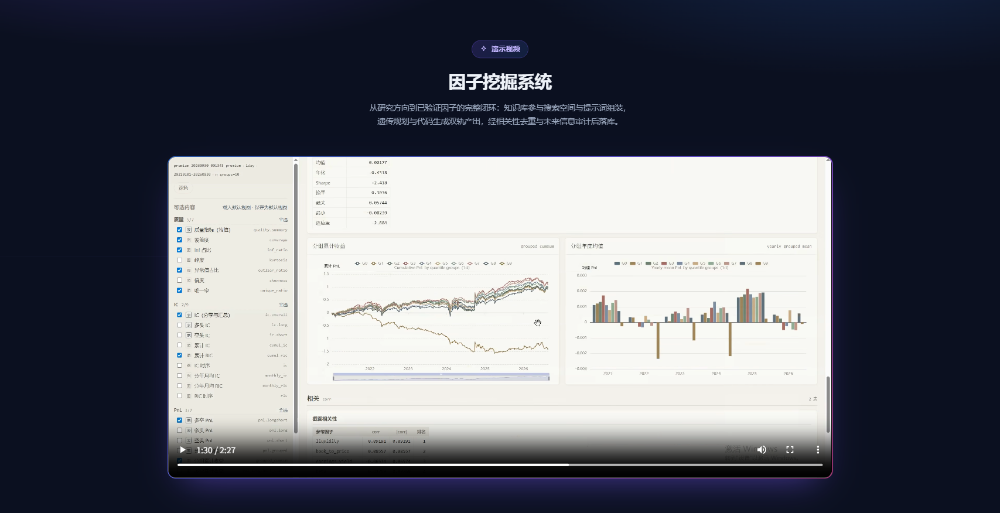
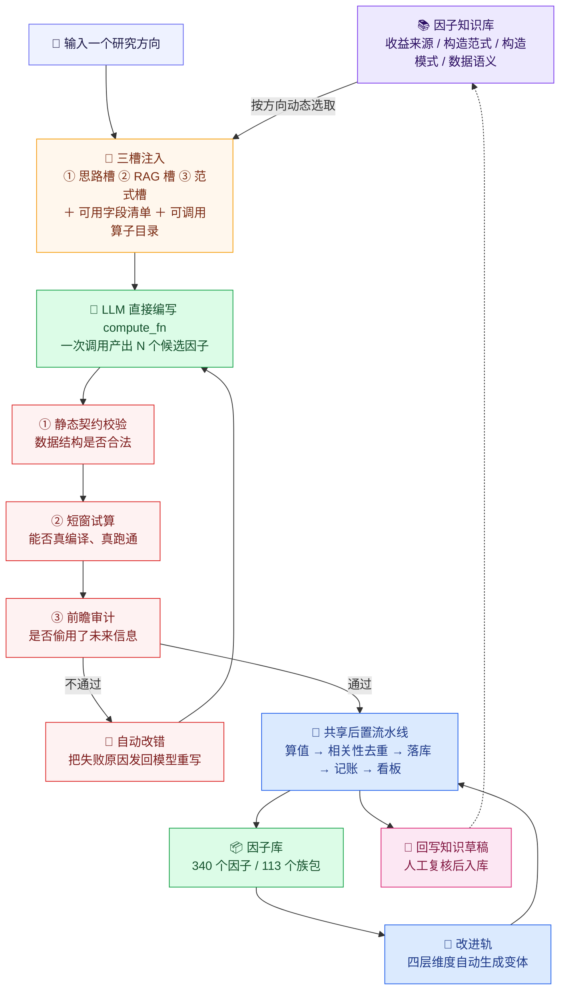
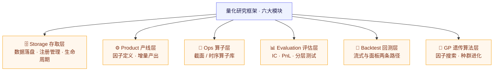
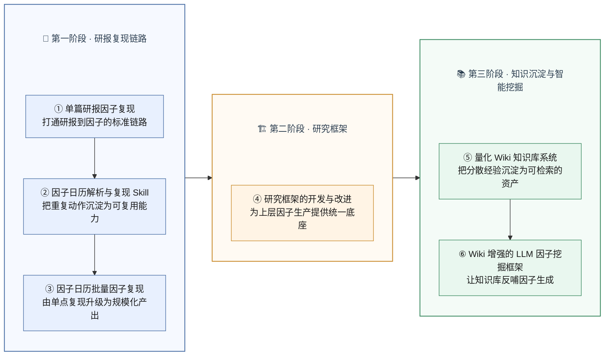

# Wiki 增强的 LLM 因子挖掘系统（WikiAlpha）

> 🎬 **在线演示视频**：<https://factor-mining-showcase.pages.dev>

**只需输入一个研究方向，系统自动完成「挖掘 → 评估 → 改进」全流程。**

传统因子挖掘强依赖人力：找方向、写逻辑、算因子、做评估、再改进，每一步都要人盯着。
本系统把知识库（Wiki）**直接接进生成环节**——不是事后查资料，而是决定「模型能看到什么」，
让大模型站在已有积累上创新，而不是从零瞎猜。

> 上图为系统 Web 控制台实拍；完整流程演示见 [在线演示视频](https://factor-mining-showcase.pages.dev)（约 2 分 28 秒）。

---

## 🎯 项目定位

| | |
|---|---|
| **服务对象** | 量化研究团队（因子挖掘 / 策略研究） |
| **解决什么** | 开源 LLM 挖因子「知识不注入、提示词一撞就收敛、产出同质化」 |
| **交付形态** | 端到端挖掘系统 + Web 控制台 + 因子库 / 因子看板 |
| **角色** | 独立设计并实现 |

---

## 🏗️ 系统流程：从方向到可用因子

让 LLM 直接编写因子计算代码（`compute_fn`），知识库通过**三槽注入**为这次生成提供上下文；
生成结果经过**三道校验**后才能进入后置流水线。

> **一句话读法**：知识库在**入口**为生成提供上下文（三槽），LLM 产出候选后经**三道校验**
> 筛掉不合法 / 跑不通 / 偷看未来的因子，再汇入**统一后置**（去重 → 落库 → 出图）；
> 改进轨把库里的因子变成变体，最后回写知识草稿——**形成复利循环**。

---

## 🧩 「Wiki 增强」怎么落地：三槽注入

系统把知识库内容组织成**三块上下文**（「三槽」），每次生成时一并喂给 LLM：

| 槽位 | 内容 | 作用 |
|---|---|---|
| **思路槽** | 从知识库自动提炼的**可操作建议** | 告诉模型「这个方向值得往哪里试」 |
| **RAG 槽** | 检索命中的**相似知识点** | 让模型看到相关机制与已有做法 |
| **范式槽** | 相关**构造范式 / 构造模式** | 给出可参考的现成构造手法 |

> 三槽都**按输入方向动态选取**——方向变了，注入的内容也跟着变，保证上下文始终与当前任务相关。

---

## ✅ 三道质量门

| 校验 | 拦截什么 | 特点 |
|---|---|---|
| ① **静态契约** | 数据结构不合法（列数 / 键列约定不符） | 秒级、零成本 |
| ② **短窗试算** | 编译不过、运行报错、产出 0 行 | 真编译真跑，抓真实错误 |
| ③ **前瞻审计** | **偷用未来信息**（用当天及之后的数据算当天因子） | **硬门**，不通过直接剔除 |

---

## ⚙️ 全流程自动化与运行池

一次提交、全链自动，无需人工看护：

- **质量硬门自动化**：前瞻审计（防未来信息泄漏）是硬门，不通过直接剔除，无需人工判断；
- **运行池调度**：多任务并行 + 排队 + 自动唤醒；槽位按「吃 CPU 的挖掘」与「等模型的思路生成」**分开计量**，避免互相饿死；
- **异常自动隔离**：进程异常可自动收养，后端重启后池子依然有效；
- **失败不静默**：产出 0 行、编译报错等结构性问题会被识别，并**自动触发模型改错**（有限次重试），修不好才淘汰。

---

## 🖥️ Web 控制台

系统提供完整的 Web 控制台，覆盖「挖什么 → 挖出来是什么 → 表现如何」的核心链路：

| 功能 | 说明 |
|---|---|
| ① **因子挖掘** | 输入研究方向即可起跑，实时日志与任务状态可见；下方是待放行的构造模式卡 |
| ② **因子库** | 所有已产出因子汇入同一张表，按 IC / RIC / IR / RIR 统一查看，支持按来源与指标筛选 |
| ③ **因子详情** | 单个因子的完整评测：IC 家族表（1d / 5d × 全样本 / 多头腿 / 空头腿）、用到的字段与算子、改进思路入口 |
| ④ **数据** | 展示可用数据的覆盖范围（每张表 / 每个字段的起止日期与天数），可勾选限定字段范围 |
| ⑤ **因子看板** | 把评测结果渲染成 12+ 张交互图：IC 曲线、累积 IC、分组 PnL、月度 IC 热力图、相关矩阵等 |

---

## 📈 已有成果

在系统跑通的基础上，已完成一轮**规模化自动挖掘**：

| 维度 | 成果 |
|---|---|
| **因子总数** | 累计自动挖掘并落库 **340 个**因子 |
| **族包总数** | **113 个**族包 |
| **评估覆盖** | 全部 **340 个**因子均在 **2021-01 ~ 2026-08（约 5.5 年）** 全样本窗口上完成评估 |
| **思路库** | 自动生成 **500 条**候选思路，覆盖 **45 个**收益机制 |
| **构造模式** | 从知识库提炼并放行 **35 条**构造模式（供因子生成参考） |
| **算子目录** | 可用算子 **138 个**（原生 103 + 扩充 35） |
| **数据范围** | 接入 **15 张表 / 213 个变量** |

**代表性因子**（2021-01 ~ 2026-08 全样本，取按最优方向归一后的绝对值）：

| 因子 | Rank IC |
|---|---:|
| `conditional_map_on_neg_rankic` | **0.0548** |
| `amount_weighted_peak_price_quantile` | **0.0486** |
| `low_amplitude_ratio_20d` | **0.0484** |
| `limit_lock_filtered_volatility` | **0.0450** |
| `quality_stable_ret` | **0.0448** |
| `ic_stability_filtered_momentum_value_composite` | **0.0435** |
| `dynamic_pca_equal_weight_composite` | **0.0389** |
| `dual_window_mapped_momentum` | **0.0357** |

> 全样本窗口下，|Rank IC| ≥ 0.03 的因子共 **30 个**，≥ 0.04 的共 **11 个**。

---

## 🔄 知识库如何真正驱动挖掘

这是本系统最核心的价值——**知识库不只是「被检索的文档」，而是直接参与因子生成的「生产资料」**：

| 知识库页面类型 | 在挖掘系统中扮演的角色 |
|---|---|
| **收益来源（Alpha）** | 作为**思路生成**的起点：围绕某个赚钱机制自动发散出可探索的方向 |
| **构造范式（Paradigm）** | 作为**范式槽**注入：给模型提供可参考的现成构造手法 |
| **构造模式（Pattern）** | 作为**可用构件**注入：给出细粒度的字段 / 掩码 / 算子写法参考 |
| **数据语义（data-semantics）** | 校准字段口径，保证新造因子与既有因子**同语义、可比** |

---

## 🏗️ 依托的量化研究框架

系统构建于团队自研的量化研究框架之上，完整覆盖六大模块：

---

## 🗺️ 在整体项目中的位置

本系统属于实习工作「知识沉淀与智能挖掘」阶段，让知识库反哺因子生成，形成完整闭环：

---

## 🧰 技术栈

| 类别 | 选型 |
|---|---|
| 语言 / 计算 | Python 3.10+ · Polars / pandas |
| 生成 | OpenAI 兼容 LLM API（DeepSeek） |
| 服务 / 前端 | FastAPI + React 18 + TypeScript（Web 控制台） |
| 配置 / 校验 | pydantic · Fire |
