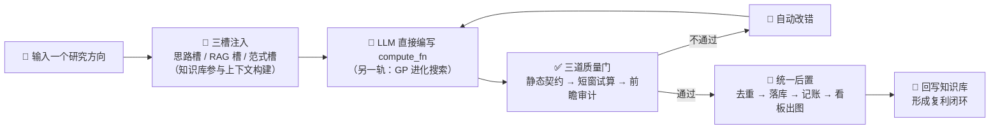

# 因子挖掘系统 · 演示视频站

> 🎬 **在线观看**：<https://factor-mining-showcase.pages.dev>
> 🖥️ 系统说明见下方「系统简介」；本仓库是该系统的**演示视频页**（纯静态、无后端）。

---

## 🎯 这是什么

这是一个**量化因子挖掘系统**（Wiki 增强的 LLM 因子挖掘框架）的演示视频页。
整页只有一个视频播放器，首页即录像，用于直观展示系统从「输入研究方向」到
「产出已验证因子」的完整闭环。



---

## 🧬 系统简介

**Wiki 增强的 LLM 因子挖掘框架**：针对现有开源 LLM 挖因子「知识不注入、提示词一撞就收敛、
产出因子同质化」的问题，只需输入一个研究方向，系统即可自动完成「**挖掘 → 评估 → 改进**」全流程。

| 环节 | 做法 |
|---|---|
| 🔍 **Wiki 增强** | 把知识库中的收益机制、构造范式与构造模式，按方向动态组织为「思路槽 / RAG 槽 / 范式槽」三块上下文 |
| 🤖 **双轨产出** | 精品轨：LLM 直接编写因子计算代码（`compute_fn`）；快轨：GP 进化搜索扩搜索空间 |
| ✅ **三道质量门** | ① 静态契约校验 → ② 短窗试算 → ③ 前瞻审计（防未来信息泄漏，**硬门**，不通过直接剔除） |
| 🔗 **统一后置** | 相关性去重 → 自动落库 → 记账 → 因子看板出图；改进轨按四层维度自动派生变体 |
| ⚙️ **规模化调度** | 运行池支持多任务并行与排队，按「吃 CPU 的挖掘 / 等模型的思路生成」分类计量，异常进程自动隔离 |

---

## 📊 核心指标

| 维度 | 成果 |
|---|---:|
| 自动挖掘落库因子 | **340 个** |
| 因子族包 | **113 个** |
| 评估窗口 | 2021-01 ~ 2026-08（约 5.5 年）全样本 |
| 最高 Rank IC | **0.0548** |
| 候选思路库 | 500 条（覆盖 45 个收益机制） |
| 构造模式 / 可用算子 | 35 条 / 138 个 |
| 接入数据 | 15 张表 / 213 个变量 |

> 代表性因子（全样本 Rank IC）：`conditional_map_on_neg_rankic` 0.0548 ·
> `amount_weighted_peak_price_quantile` 0.0486 · `low_amplitude_ratio_20d` 0.0484 ·
> `limit_lock_filtered_volatility` 0.0450 等。

---

## 🖥️ 演示内容

录像为系统 **Web 控制台的完整演示**，覆盖「挖什么 → 挖出来是什么 → 表现如何」的核心链路：

- **① 因子挖掘**：输入研究方向即可起跑，实时日志与任务状态可见；
- **② 因子库**：所有已产出因子汇入同一张表，按 IC / RIC / IR / RIR 统一查看；
- **③ 因子详情**：单个因子的完整评测（IC 家族表、用到的字段与算子、改进思路入口）；
- **④ 数据**：可用数据覆盖范围（每张表 / 每个字段的起止日期与天数）；
- **⑤ 因子看板**：把评测结果渲染成 12+ 张交互图（IC 曲线、累积 IC、分组 PnL、月度 IC 热力图、相关矩阵等）。

---

## ⚙️ 页面实现

纯静态、无后端，只做一件事：稳定地播放一段演示录像。

```text
site/index.html        视频播放页（含海报层，点击后才加载视频）
site/media/av1.mp4     AV1 · 2560×1238 · 约 11.9 MiB
site/media/h264.mp4    H.264 · 1920×928 · 约 18.6 MiB（兼容性回退）
site/media/poster.jpg  封面（1600 宽，约 119 KB）
site/robots.txt        Disallow: /
```

- 页面用 `<source>` 依次声明 AV1 与 H.264，浏览器自动挑选支持的格式。
- 采用「**先下载到本地再播放** + 海报层」策略，保证进度条可自由拖动。

---

## ⚠️ 重要：不要添加 `_headers` 文件

本仓库**刻意不含** `_headers`。原因是它会让 Cloudflare Pages 的响应失去 HTTP Range 支持，
浏览器拿不到 `206 Partial Content` 就判定整段视频不可跳转，**进度条因此拖不动**。

| 部署 | `_headers` | 第 1 秒 `video.seekable` | 跳到 98s |
|---|---|---|---|
| 含 `_headers` | ✅ 有 | `[0, 0]`（持续 8s 以上） | ❌ 失败，弹回 1.7s |
| 已移除 | ❌ 无 | `[0, 147.9]` | ✅ 成功 |

**替代方案**：noindex 改用 `robots.txt`（`Disallow: /`）+ HTML 里的
`<meta name="robots" content="noindex">`，两者已足够且不影响媒体分段。

---

## 🚀 本地预览 / 部署

```bash
# 本地预览
cd site && python -m http.server 8000     # → http://localhost:8000

# 部署（注意：只部署 site/，不要部署仓库根目录）
npx wrangler pages deploy site --project-name factor-mining-showcase --branch main
```

> ⚠️ **不要部署仓库根目录**。早先直接 `wrangler pages deploy .` 会把
> `README.md`、`.gitignore` 等一并上传，**在线上可被任意下载**。站点文件收进 `site/` 后即可避免。
> ⚠️ 单文件不得超过 Cloudflare Pages 的 **25 MiB** 上限，替换视频时请先确认体积。

---

## 📄 说明

- 页面为 `noindex`，不参与搜索引擎收录。
- 单文件均在上限内（AV1 约 11.9 MiB、H.264 约 18.6 MiB），音轨为 BGM（源录像音轨为数字静音，已直接替换）。
